# Phishing Website Detection with Machine Learning: Full vs. Deployable Feature Sets

*Machine Learning course project. Every number, table and figure in this report was produced by the code in this repository (`python -m src.run_all`, plus `python -m src.live_check` for Section 8.3) and is read from `results/`.*

## Abstract

We classify websites as phishing or legitimate using the UCI Phishing Websites dataset (11,055 sites, 30 ternary features). We compare a Decision Tree, a Random Forest, an RBF-kernel SVM and XGBoost on two feature sets. The **full** set has all 30 features. The **lite** set has the 21 features a program can compute from a live URL and its static HTML. On the full set, all three ensemble or kernel models reach about 97.6% test accuracy (Random Forest: accuracy 0.9769, F1 0.9738, ROC-AUC 0.9964). Restricting to the lite set costs about 3 percentage points (best lite accuracy 0.9480).

Two findings qualify these headline numbers. First, 47% of the dataset's rows are exact duplicates. Removing them before splitting lowers F1 by 2.3–4.0 points for every model. Second, the dataset's encoding of several URL features does not match its own documentation. For example, 79% of *legitimate* rows are coded as having a long URL. A live extractor that follows the documented rules therefore produces feature distributions the models never saw.

Feature-importance methods (built-in, permutation, SHAP) largely agree. The top features are `sslfinal_state` and `url_of_anchor`, followed by `web_traffic`. The full-vs-lite gap comes from the combined effect of the excluded reputation features (traffic rank, backlinks, domain age, Google index, PageRank), not from any single one. We deploy the best lite model, XGBoost, behind a FastAPI service and a Chrome extension.

## 1. Introduction and problem statement

Phishing websites imitate trusted sites to steal credentials and payment details. Blacklists react only after a site has been reported, so there is long-standing interest in classifiers that judge a site from its own properties: its URL, page content and domain information.

**Task.** Binary classification: given a website, predict *phishing* (positive class, label 1) or *legitimate* (label 0). Missing a phishing site is usually worse than a false alarm, so we report precision, recall and F1 for the phishing class, and use F1 as the tuning metric.

**The deployment problem.** The dataset contains no raw URLs, only 30 pre-computed features. Several of them cannot realistically be computed today. Alexa traffic rank and Google PageRank are discontinued. Google-index checks, backlink counts and WHOIS lookups are slow, rate-limited or unreliable. We therefore train on two feature sets:

- **Full (30 features):** the academic comparison of the four models.
- **Lite (21 features):** only the features our extractor (`src/extract.py`) computes from a URL and its fetched HTML in a few seconds. The best lite model is served by the demo.

The size of the full-vs-lite gap, and which features account for it, is a core result (Section 7).

## 2. Related work

Mohammad, Thabtah and McCluskey built this dataset and proposed its feature rules [1, 2], and used it to train rule-based and self-structuring neural-network classifiers [3]. The dataset has since become a common benchmark for comparing classifiers, often tree ensembles. Earlier, CANTINA [4] classified pages by their text content (TF-IDF terms plus a search-engine query), with heuristics for URL and form features. Blacklist services such as PhishTank [5] and Google Safe Browsing complement such classifiers rather than replace them. We use standard tools: Random Forests [6], XGBoost [7], SHAP [8] for explanations, and permutation importance [6, 9].

## 3. Dataset

**Source.** UCI Machine Learning Repository, dataset 327 [1], loaded with `ucimlrepo`. If that fails, the code downloads the original ARFF from the UCI archive; we checked that both paths give identical data. The data is cached in `data/`.

**Size and labels.** 11,055 rows and 30 features. The target `result` is coded −1 = phishing and 1 = legitimate. We checked this against the documentation and the authors' class counts: 4,898 phishing (44.3%) and 6,157 legitimate. As further confirmation, rows with `url_of_anchor` = −1 are 99% phishing. We map the target to **phishing = 1**.

**Features.** All features are coded −1 (phishing-like), 0 (suspicious, for 3-level features) or 1 (legitimate-like). The exception is `redirect`, which takes only the values 0 and 1. There are four groups: address-bar features (IP host, URL length, shortener, `@`, `//`, `-` in domain, subdomains, HTTPS, port, `https` token), HTML/JS features (favicon, request URL, anchors, links in tags, form handler, mailto, redirects, mouseover, right-click, pop-up, iframe), domain features (registration length, age, DNS record, abnormal URL), and reputation features (web traffic, PageRank, Google index, backlinks, blacklist reports). Per-value counts and phishing rates are in `results/feature_value_counts.csv`.

**Duplicates.** With 30 ternary features, many sites share a feature vector:

| Quantity | Value |
|---|---|
| Rows | 11,055 |
| Exact duplicate rows (features + label) | 5,206 (47%) |
| Unique rows | 5,849 |
| Feature vectors that occur with *both* labels | 64 |

A duplicate that lands on both sides of a random split makes the test set easier than unseen data would be. We report headline results on the standard split, as is common for this dataset, and add a sensitivity check on de-duplicated data (Section 5.3).

**Encoding does not always follow the documentation.** We compared each feature's value counts with the documented rules. Several do not fit:

- `url_length` = −1 ("longer than 75 characters") for 81% of all rows. `prefix_suffix` = −1 ("`-` in the domain") for 87% of rows, and its +1 value occurs *only* on legitimate sites (phishing rate 0.00). `sfh` = −1 ("empty form action") for 76% of rows.
- For `shortining_service`, `double_slash_redirecting`, `https_token`, `abnormal_url` and `domain_registration_length`, the "phishing-like" value −1 actually has a *lower* phishing rate than +1. These features run opposite to their documented direction.
- `redirect` is documented as a 3-level rule (≤1 redirect legitimate, 2–3 suspicious, ≥4 phishing) but contains only 0 (88% of rows) and 1 (12%). Since 0 is the large majority, it must mean "≤1 redirect"; our extractor maps ≤1 → 0 and ≥2 → 1.
- `favicon`, `popupwindow`, `iframe` and `rightclick` have nearly identical phishing rates for both values (0.44–0.47), so on their own they carry almost no signal.

These quirks do not hurt the offline comparison, since every model sees the same data. They matter a lot for the live demo (Section 8.3).

## 4. Methodology

### 4.1 Preprocessing and split

The features are already numeric and ordinal (−1 < 0 < 1), so they are used as they are. Tree models need no scaling; the SVM is wrapped in a `StandardScaler` pipeline. We use a stratified 80/20 train/test split with `random_state=42` (8,844 training and 2,211 test rows). Tuning and model selection use only the training set. The test set is used once, by `src/evaluate.py`, plus the permutation-importance and ablation analyses in Section 6.

### 4.2 Models and hyper-parameter grids

Grids are kept small so the whole pipeline runs in about 7 minutes on a laptop CPU (405 s measured for `src.run_all`).

| Model | Grid | Best (full) | Best (lite) |
|---|---|---|---|
| Decision Tree | criterion ∈ {gini, entropy}; max_depth ∈ {None, 10, 20}; min_samples_leaf ∈ {1, 2, 5} | entropy, depth 20, leaf 1 | entropy, depth None, leaf 1 |
| Random Forest | n_estimators ∈ {200, 400}; max_depth ∈ {None, 20}; max_features ∈ {sqrt, 0.5} | 200 trees, depth None, sqrt | 400 trees, depth 20, sqrt |
| SVM (RBF, `probability=True`) | C ∈ {1, 10, 100}; gamma ∈ {scale, 0.1, 0.01} | C=10, γ=0.1 | C=10, γ=0.1 |
| XGBoost (hist, subsample 0.8, colsample 0.8) | n_estimators ∈ {200, 400}; max_depth ∈ {4, 6, 8}; learning_rate ∈ {0.05, 0.1} | 200 trees, depth 8, lr 0.1 | 400 trees, depth 8, lr 0.1 |

Several XGBoost optima sit at the edge of the grid (depth 8, learning rate 0.1). A larger grid might gain slightly; we kept it small for runtime.

### 4.3 Evaluation protocol

- **Tuning:** `GridSearchCV` with 5-fold stratified CV (shuffled, seed 42) on the training set, scoring F1 for the phishing class. The best configuration is refit on the whole training set.
- **Test metrics:** accuracy, precision, recall, F1 (phishing class) and ROC-AUC, at a 0.5 probability threshold.
- **Cost:** *training time* is the refit time of the best configuration on the full training set. *Inference time* is the median of 200 single-row `predict_proba` calls (one thread), which mimics one API request.
- **Serving-model choice:** the lite model with the best CV F1. Models within 0.001 of the best count as tied, and ties go to the fastest single prediction. The choice and its reason are written to `models/serving.json`.
- **Seeds** are fixed everywhere. A second run from an empty folder reproduced every metric exactly; only the wall-clock timings changed.

## 5. Results

### 5.1 Full feature set (30 features)

Test set, n = 2,211 (from `results/metrics_full.md`):

| Model | Accuracy | Precision | Recall | F1 | ROC-AUC | CV F1 mean | CV F1 std | Train time (s) | Inference (ms) |
|---|---|---|---|---|---|---|---|---|---|
| Decision Tree | 0.9670 | 0.9680 | 0.9571 | 0.9625 | 0.9780 | 0.9564 | 0.0049 | 0.0238 | 0.5800 |
| Random Forest | 0.9769 | 0.9804 | 0.9673 | 0.9738 | 0.9964 | 0.9659 | 0.0026 | 0.6337 | 9.3525 |
| SVM (RBF) | 0.9756 | 0.9773 | 0.9673 | 0.9723 | 0.9904 | 0.9595 | 0.0032 | 5.1886 | 0.8449 |
| XGBoost | 0.9760 | 0.9764 | 0.9694 | 0.9729 | 0.9969 | 0.9649 | 0.0019 | 0.2250 | 2.5053 |

Random Forest, SVM and XGBoost are within 0.15 accuracy points of each other, a difference of 1–3 test sites out of 2,211. That is too small to call one of them better. XGBoost has the best phishing recall (950 of 980 phishing sites caught) and the highest ROC-AUC. The single Decision Tree is clearly behind (F1 0.9625) and has a much lower ROC-AUC, because a single tree outputs only a few distinct probabilities. The SVM is the slowest to train (5.2 s); the Random Forest is the slowest per prediction (9.4 ms).

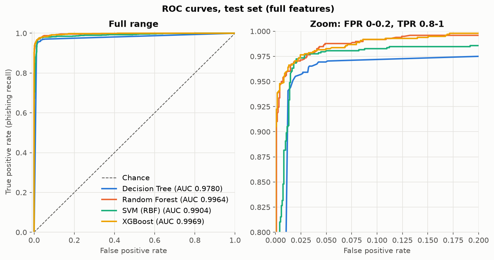

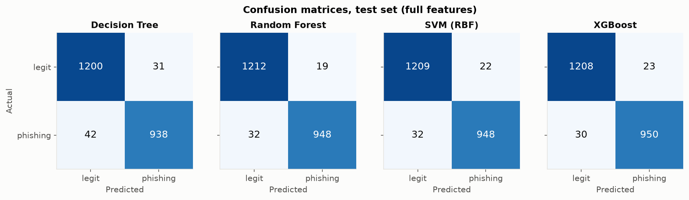

### 5.2 Lite feature set (21 features)

Test set, same rows (from `results/metrics_lite.md`):

| Model | Accuracy | Precision | Recall | F1 | ROC-AUC | CV F1 mean | CV F1 std | Train time (s) | Inference (ms) |
|---|---|---|---|---|---|---|---|---|---|
| Decision Tree | 0.9453 | 0.9343 | 0.9429 | 0.9385 | 0.9826 | 0.9392 | 0.0030 | 0.0278 | 0.9806 |
| Random Forest | 0.9480 | 0.9445 | 0.9378 | 0.9411 | 0.9896 | 0.9438 | 0.0031 | 1.2490 | 19.6502 |
| SVM (RBF) | 0.9475 | 0.9463 | 0.9347 | 0.9405 | 0.9793 | 0.9412 | 0.0011 | 6.2954 | 1.1016 |
| XGBoost | 0.9462 | 0.9434 | 0.9347 | 0.9390 | 0.9905 | 0.9438 | 0.0038 | 0.3718 | 2.5481 |

All four lite models land within 0.3 accuracy points of each other, about 3 points below the full set. The models differ less than on the full set: with fewer, coarser features there is less structure for the ensembles to exploit beyond a single tree.

**Serving model.** Random Forest and XGBoost tie on CV F1 (both 0.9438). XGBoost is chosen because a single prediction takes 2.5 ms against 19.7 ms for the 400-tree forest (reason recorded in `models/serving.json`). Its test F1 (0.9390) is slightly below the Random Forest's (0.9411); model selection deliberately ignores the test set.

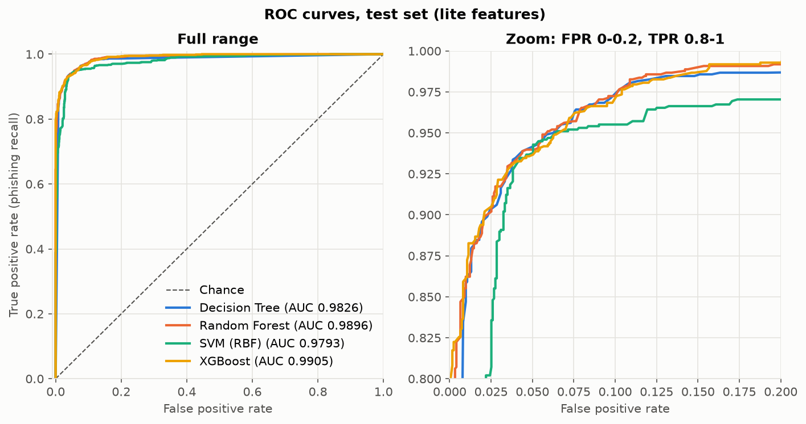

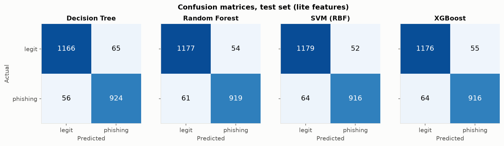

### 5.3 Sensitivity to duplicate rows

We refit each model's tuned configuration on a split made *after* removing exact duplicates, then scored it on the de-duplicated test set (`results/dedup_sensitivity.md`). Duplicates are removed within each feature set's own columns. Dropping 9 features makes many more rows identical, so the lite data shrinks to 3,063 unique rows.

| Features | Model | Train rows | Test rows | Accuracy (dedup) | F1 (dedup) | ROC-AUC (dedup) | Accuracy (standard) | F1 (standard) | F1 change |
|---|---|---|---|---|---|---|---|---|---|
| full | Decision Tree | 4679 | 1170 | 0.9265 | 0.9279 | 0.9360 | 0.9670 | 0.9625 | -0.0347 |
| full | Random Forest | 4679 | 1170 | 0.9410 | 0.9420 | 0.9852 | 0.9769 | 0.9738 | -0.0318 |
| full | SVM (RBF) | 4679 | 1170 | 0.9359 | 0.9370 | 0.9734 | 0.9756 | 0.9723 | -0.0353 |
| full | XGBoost | 4679 | 1170 | 0.9487 | 0.9499 | 0.9928 | 0.9760 | 0.9729 | -0.0229 |
| lite | Decision Tree | 2450 | 613 | 0.8989 | 0.8990 | 0.9135 | 0.9453 | 0.9385 | -0.0395 |
| lite | Random Forest | 2450 | 613 | 0.9184 | 0.9172 | 0.9766 | 0.9480 | 0.9411 | -0.0239 |
| lite | SVM (RBF) | 2450 | 613 | 0.9119 | 0.9097 | 0.9644 | 0.9475 | 0.9405 | -0.0308 |
| lite | XGBoost | 2450 | 613 | 0.9152 | 0.9136 | 0.9842 | 0.9462 | 0.9390 | -0.0254 |

Every model loses 2.3–4.0 F1 points. Part of the headline accuracy is therefore memorisation of repeated rows. On unique feature vectors, the realistic full-set accuracy is about 93–95%, and about 90–92% for lite. Two caveats: the de-duplicated data has a different class balance (51.6% phishing for full, 48.1% for lite, against 44.3% originally), and the training set is about half the size. So not all of the drop is leakage. The ranking also changes: XGBoost is the most robust model on de-duplicated data (best full-set accuracy 0.9487, smallest F1 drop).

## 6. Feature-importance analysis

All analyses use the full feature set (`src/importance.py`). The "best tree model" for SHAP and the ablation is the one with the highest full-set CV F1, the **Random Forest** (0.9659, against 0.9649 for XGBoost).

### 6.1 Built-in importances

Decision Tree and Random Forest use mean decrease in impurity; XGBoost uses gain. Each is normalised to sum to 1.

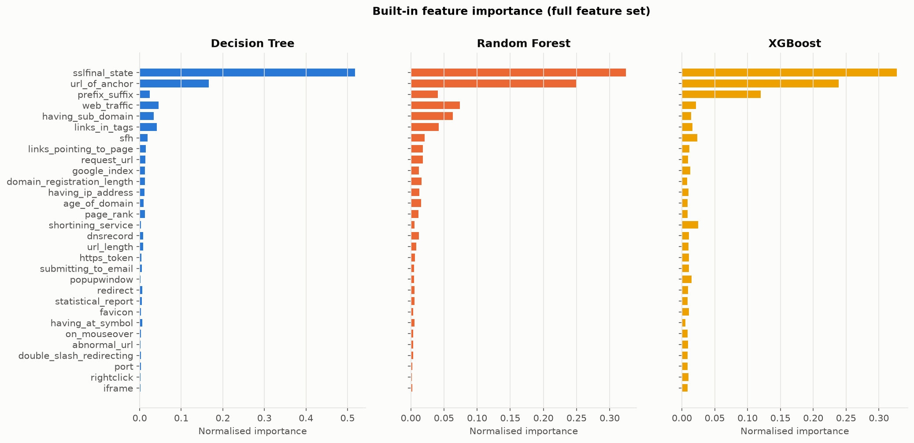

### 6.2 Permutation importance (test set, all four models)

This is the drop in test F1 when one feature's column is shuffled (10 repeats). It is the only option for the SVM, and the fairest cross-model comparison, because it measures the same quantity for every model.

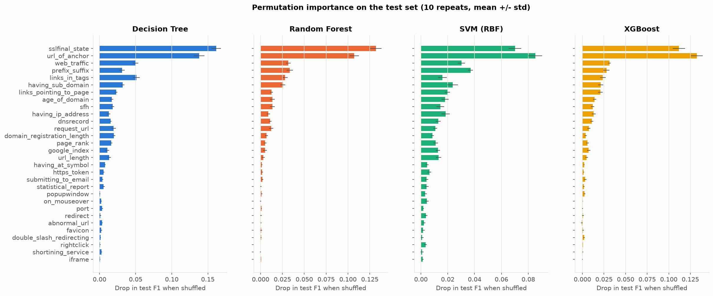

`sslfinal_state` and `url_of_anchor` dominate for every model. Shuffling either costs 7–16 F1 points. Next come `web_traffic`, `prefix_suffix`, `links_in_tags` and `having_sub_domain` (1.5–5 points each). About ten features (`iframe`, `rightclick`, `port`, `favicon`, `redirect`, ...) have near-zero permutation importance for all models. That fits their flat phishing rates in Section 3.

### 6.3 SHAP (Random Forest)

TreeSHAP on a 200-tree, unlimited-depth forest took about 75 ms per row. We therefore computed it on 500 randomly sampled test rows for the plots.

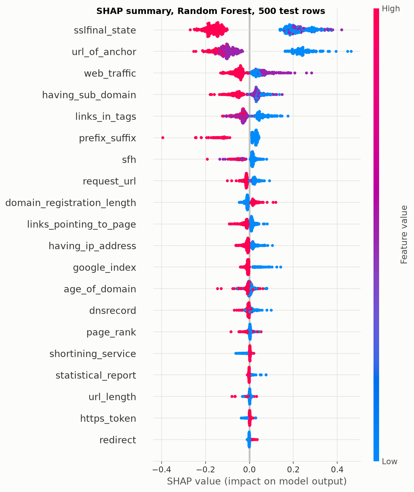

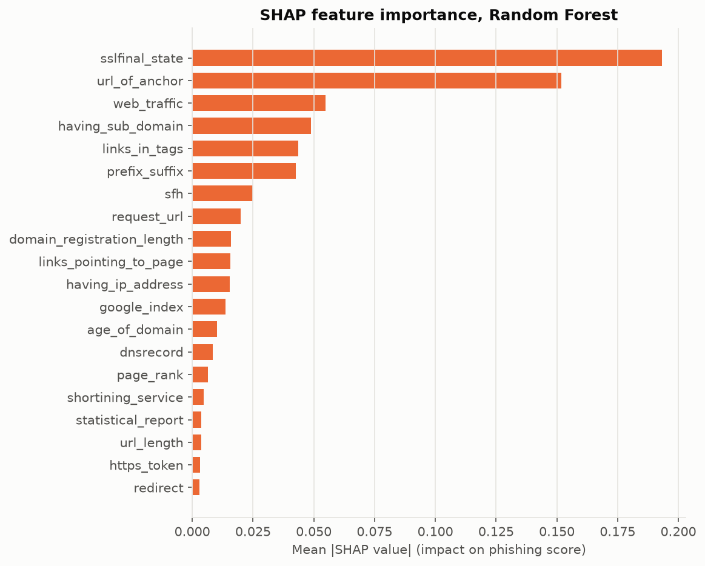

The beeswarm shows the *direction* of each effect. Low (−1) values of `sslfinal_state`, `url_of_anchor` and `prefix_suffix` push towards phishing; high values push towards legitimate. `prefix_suffix` = +1 occurs only on legitimate sites in the data (phishing rate 0.00), so it acts as a near-certain legitimacy flag. `domain_registration_length` runs the other way: its −1 value pushes towards *legitimate*, matching the inverted direction found in Section 3.

### 6.4 Do the methods agree?

Spearman rank correlation between the 8 importance rankings over all 30 features (`results/importance_spearman.csv`):

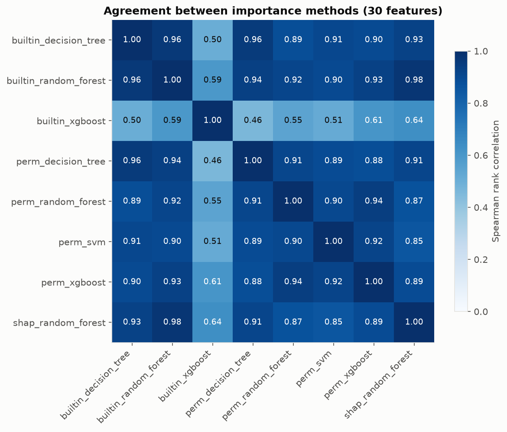

Top-5 features per method, and the overlap of each method's top 10 with the consensus top 10 (mean rank over all methods):

| method | top5 | top10_overlap_with_consensus |
|---|---|---|
| builtin_decision_tree | sslfinal_state, url_of_anchor, web_traffic, links_in_tags, having_sub_domain | 9 |
| builtin_random_forest | sslfinal_state, url_of_anchor, web_traffic, having_sub_domain, links_in_tags | 9 |
| builtin_xgboost | sslfinal_state, url_of_anchor, prefix_suffix, shortining_service, sfh | 7 |
| perm_decision_tree | sslfinal_state, url_of_anchor, links_in_tags, web_traffic, having_sub_domain | 9 |
| perm_random_forest | sslfinal_state, url_of_anchor, prefix_suffix, web_traffic, links_in_tags | 10 |
| perm_svm | url_of_anchor, sslfinal_state, prefix_suffix, web_traffic, having_sub_domain | 9 |
| perm_xgboost | url_of_anchor, sslfinal_state, web_traffic, prefix_suffix, links_in_tags | 9 |
| shap_random_forest | sslfinal_state, url_of_anchor, web_traffic, having_sub_domain, links_in_tags | 9 |

**Consensus top 10:** `sslfinal_state`, `url_of_anchor`, `web_traffic`, `prefix_suffix`, `links_in_tags`, `having_sub_domain`, `sfh`, `links_pointing_to_page`, `request_url`, `age_of_domain`.

The methods agree strongly. The mean pairwise Spearman correlation is 0.823, and 0.914 (minimum 0.853) when XGBoost's gain-based ranking is left out. Every method puts `sslfinal_state` and `url_of_anchor` in its top two.

The outlier is XGBoost's built-in gain importance (correlation 0.46–0.64 with the others). It ranks `shortining_service` 4th, while permutation importance for the *same* XGBoost model puts that feature near zero. Gain rewards features that produce large loss reductions on the few rows where they split. A feature that cleanly separates a small, pure group of duplicated rows can therefore get high gain without mattering much on held-out data. This is a known weakness of gain importance, and the reason we prefer permutation importance and SHAP for conclusions.

### 6.5 Ablation: how many features are needed?

We ranked features by mean |SHAP| on 500 *training* rows, so feature selection never sees the test set. We then refit the Random Forest configuration on the top-k features (`results/ablation.md`):

| k | cv_accuracy | cv_f1 | test_accuracy |
|---|---|---|---|
| 5 | 0.9334 | 0.9232 | 0.9303 |
| 10 | 0.9471 | 0.9397 | 0.9480 |
| 15 | 0.9634 | 0.9583 | 0.9697 |
| 20 | 0.9661 | 0.9616 | 0.9738 |
| 30 | 0.9699 | 0.9659 | 0.9769 |

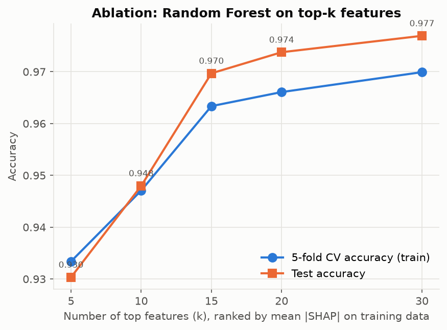

Five features (`having_sub_domain`, `sslfinal_state`, `url_of_anchor`, `links_in_tags`, `web_traffic`) already give 93% accuracy. Fifteen features reach 97.0% test accuracy, about 0.7 points below all thirty. The last ten features add little; they include most of the near-zero features from Section 6.2. The k = 30 row reproduces the main model's test accuracy exactly (0.9769), which confirms the ablation uses the same configuration.

## 7. Full vs. lite: where does the gap come from?

The lite set drops nine features: `domain_registration_length`, `abnormal_url`, `popupwindow`, `age_of_domain`, `web_traffic`, `page_rank`, `google_index`, `links_pointing_to_page` and `statistical_report`. Of these, `web_traffic` (consensus rank 3), `links_pointing_to_page` (8) and `age_of_domain` (10) are in the consensus top 10. The lite set keeps the two most important features overall.

To measure what the excluded features contribute, we added them back to the lite set one at a time, then cumulatively in consensus-importance order. We used the Random Forest configuration with 5-fold CV on the training set, so this needs no test data (`results/lite_gap.md`). The CV F1 gap to explain is 0.9659 − 0.9434 = 0.0225.

| Feature set | Added | CV F1 | Share of gap recovered |
|---|---|---|---|
| lite (21) | | 0.9434 | 0% |
| lite + 1 | links_pointing_to_page | 0.9480 | 21% |
| lite + 1 | web_traffic | 0.9475 | 18% |
| lite + 1 | page_rank | 0.9452 | 8% |
| lite + 1 | age_of_domain | 0.9443 | 4% |
| lite + 1 | any of the other five | 0.9422–0.9436 | −5% to +1% |
| lite + top 2 | web_traffic, links_pointing_to_page | 0.9536 | 45% |
| lite + top 3 | + age_of_domain | 0.9576 | 63% |
| lite + top 4 | + google_index | 0.9602 | 75% |
| lite + top 6 | + domain_registration_length, page_rank | 0.9648 | 95% |
| lite + top 7 | + statistical_report | 0.9658 | 99% |
| full (30) | all 9 | 0.9659 | 100% |

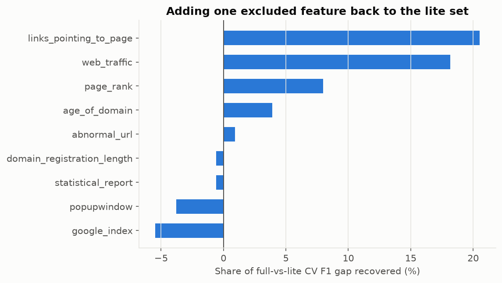

**Interpretation.** No single excluded feature explains much of the gap: the best, `links_pointing_to_page`, recovers 21%. Together, however, the reputation features recover all of it, and the first two together recover 45%, more than the sum of their single effects (39%). The missing information is *site reputation*: how popular and well-linked a site is, and how old it is. These signals overlap one another and combine with the page features. Single-feature changes of ±0.001 F1 are within CV noise (fold standard deviation ≈ 0.003), so the slightly negative values for `google_index` and `popupwindow` mean "no effect", not "harmful". In short: the gap is the cost of not knowing a site's reputation, and the URL/HTML features cannot fully stand in for it. Modern replacements for these signals (Tranco rank lists, certificate-transparency logs, RDAP for domain age) are a natural extension; see Section 10.

## 8. Demo

### 8.1 Live feature extractor (`src/extract.py`)

The extractor turns a URL into the 21 lite features using the authors' encoding. It is built from pure functions (`url_features`, `page_features`) plus two network calls (`fetch`, `dns_resolves`), so every rule is unit-tested without a network. It follows the documented rules in [2], with these choices:

- **Network limits:** 5 s timeouts on DNS and HTTP, at most 10 redirects, 2 MB response cap, a 10 s overall read deadline, and static HTML only (no JavaScript is executed).
- **`sslfinal_state` (approximation):** the authors used issuer trust and certificate age, which we cannot check reliably. We use: HTTPS with a certificate that validates → 1; HTTPS with a certificate error → 0 (the page is then re-fetched without verification so the HTML features can still be computed); no HTTPS → −1.
- **`having_sub_domain`:** the authors drop `www.` and the country-code TLD, then count dots. This equals counting subdomain labels below the registered domain (`hud.ac.uk` → 1, `mail.example.com` → 0, `a.b.example.com` → −1). We use the public-suffix list bundled with `tldextract`, offline.
- **`redirect`:** ≤1 redirect → 0, ≥2 → 1 (see Section 3).
- **`rightclick` (approximation):** besides the documented `event.button==2`, we also count `oncontextmenu="return false"`.
- **`prefix_suffix` (approximation):** we check for `-` anywhere in the host name.
- **`sfh`:** a `<form>` without an `action` attribute counts as empty (−1).
- **Unavailable features:** if the host does not resolve, or the page cannot be fetched, the URL-only features are still returned. Page features are marked unavailable and filled with **their most common value in the training data** (stored in `models/serving.json`), and the API sets `partial_features: true`. We chose the mode because it always lies in the training distribution. A middle value of 0 would be out of distribution for binary features. The drawback is that most modes are "legitimate-like", so a partial result leans towards *legitimate*. The UI warns about this. If a plain-`http` URL cannot be fetched, `sslfinal_state` = −1 is still known from the URL itself.

No feature from the spec had to be dropped as impractical. All 21 compute in roughly 0.1–2 s per site.

### 8.2 API and clients

`api/main.py` (FastAPI, bound to 127.0.0.1) loads the serving model once at startup:

- `POST /predict` with `{"url": ...}` returns the label, phishing probability, all 21 features (value, meaning, whether computed), the partial-features flag, and the top 5 reasons. The reasons are **per-prediction SHAP values** from `TreeExplainer` on the served XGBoost model, in log-odds units with positive = towards phishing. If a non-tree model were served, the API would fall back to occlusion: the probability change when a feature is replaced by its training mode.
- Only `http`/`https` URLs with a host name, up to 2,048 characters, are accepted; anything else gets HTTP 422.
- `GET /health` and `GET /` (a minimal try-it page) are also provided. CORS allows only `chrome-extension://` origins and localhost.

The **Chrome extension** (`extension/`, Manifest V3) asks only for `activeTab` and host access to `http://127.0.0.1:8000/*`. When its popup is opened, it posts the current tab's URL to the local API and shows the verdict, probability and top reasons. If the API is not running, it says so and shows the start command. It collects nothing in the background.

**Tests** (`python -m pytest`, 103 tests, all passing) cover every URL rule with hand-written URLs, every page rule with HTML fixtures, the extractor's partial-result paths with fake network functions, the API (`/health`, a mocked prediction, malformed-input rejection, CORS), and a smoke test that every saved model loads and predicts.

### 8.3 How the live extractor's features compare with the dataset

`src/live_check.py` ran the deployed pipeline on 20 well-known legitimate sites (Google, Wikipedia, GitHub login, PayPal sign-in, BBC, gov.uk, etc.; run 2026-10-10). All 20 pages were fetched, none was flagged as phishing, and the mean phishing probability was below 0.0001. This is a check for false alarms only. Popular sites are easy cases, and the check says nothing about recall on real phishing pages (none were fetched).

More informative is how often each feature takes its phishing-like value (−1) on these live legitimate sites, compared with the *legitimate* rows of the dataset (`results/live_vs_dataset.md`, selected rows):

| feature | dataset legit share of −1 | live legit share of −1 |
|---|---|---|
| url_length | 0.79 | 0.00 |
| prefix_suffix | 0.76 | 0.00 |
| sfh | 0.68 | 0.05 |
| having_ip_address | 0.30 | 0.00 |
| dnsrecord | 0.28 | 0.00 |
| having_sub_domain | 0.25 | 0.00 |
| favicon | 0.19 | 0.35 |
| links_in_tags | 0.25 | 0.25 |
| request_url | 0.30 | 0.20 |

By the documented rules, 79% of the dataset's legitimate sites have URLs over 75 characters, 76% have a dash in the domain, 30% are raw IP addresses and 28% have no DNS record. None of this is plausible for real legitimate sites, and none of it shows up in our live sample. For these features **the extractor's distribution cannot match the dataset's**. Whatever process produced those codes was not the documented rule. The model has therefore learned, for example, that `prefix_suffix` = +1 (no dash) strongly signals legitimacy, and every dash-free live URL gets that push. That is one reason almost any popular site scores near 0. A phishing site on a dash-free domain with a valid certificate gets the same push.

The page features (`favicon`, `links_in_tags`, `request_url`) match better. `favicon` and `request_url` differ in the direction you would expect today: modern sites serve assets from CDN domains (e.g. GitHub from `githubassets.com`), which these rules count as "external".

## 9. Limitations

1. **The data is old (≈2012–2015).** HTTPS was then a strong legitimacy signal, and `sslfinal_state` is the most important feature in every analysis. Today most phishing sites have free, valid certificates (e.g. Let's Encrypt), so this signal is much weaker, and the live demo will miss many modern phishing pages that have valid HTTPS and clean-looking HTML. **High test accuracy on this dataset does not mean high real-world accuracy.** We did not measure real-world recall.
2. **Duplicates inflate the headline numbers.** On de-duplicated data, F1 is 2.3–4.0 points lower (Section 5.3).
3. **Encoding mismatch.** Several features in the dataset do not follow their documented rules, and some run in the opposite direction (Section 3). The live extractor follows the documented rules, so its feature distribution differs from training (Section 8.3), and the deployed model's probabilities should not be read as calibrated.
4. **Approximations.** `sslfinal_state` ignores issuer trust and certificate age; `prefix_suffix`, `rightclick` and `sfh` interpret ambiguous rules (Section 8.1). Filling unavailable features with the training mode biases partial results towards "legitimate".
5. **Static HTML only.** Pages that build their content or forms with JavaScript, and cloaked sites that show different content to non-browser clients, are not analysed correctly.
6. **Small grids.** Some optimal hyper-parameters sit on the grid boundary. SHAP is computed on 500-row samples.
7. **Serving the extractor fetches untrusted pages.** It only parses HTML (no scripts run, size and time limits), and the API binds to 127.0.0.1 only. It is a demo, not a hardened service.

## 10. Conclusion

On the UCI Phishing Websites dataset, Random Forest, RBF-SVM and XGBoost all reach about 97.6% test accuracy (F1 ≈ 0.973), clearly above a single Decision Tree (96.7%). Their differences are within a few test sites. Restricting to the 21 features a live extractor can compute costs about 3 points of accuracy (94.5–94.8%). That gap comes from the combined effect of the excluded site-reputation features, chiefly backlinks and traffic rank, rather than from any single feature.

Built-in, permutation and SHAP importance agree that `sslfinal_state` and `url_of_anchor` drive the predictions; XGBoost's gain importance is the one unreliable method. Fifteen well-chosen features match the full set within 0.7 points.

Two cautions come out of the analysis. Removing the 47% duplicate rows lowers F1 by 2–4 points. More fundamentally, several features are encoded inconsistently with their documentation, which limits how well a model trained on this dataset can transfer to live websites. The working demo makes this visible: it gives sensible, explained verdicts on known sites, but its features show exactly where the 2015 dataset and today's web differ. Promising next steps are a dataset collected with a known, reproducible extractor (so training and serving encodings match by construction), current reputation signals (Tranco rank, certificate-transparency logs, RDAP domain age), and evaluation on a fresh feed of verified phishing URLs.

## References

1. R. M. Mohammad, F. Thabtah, L. McCluskey. *Phishing Websites* [dataset]. UCI Machine Learning Repository. https://archive.ics.uci.edu/dataset/327/phishing+websites
2. R. M. Mohammad, F. Thabtah, L. McCluskey. "Phishing Websites Features." Document distributed with [1].
3. R. M. Mohammad, F. Thabtah, L. McCluskey. "Predicting phishing websites based on self-structuring neural network." *Neural Computing and Applications* 25(2), 2014.
4. Y. Zhang, J. Hong, L. Cranor. "CANTINA: A content-based approach to detecting phishing web sites." *WWW 2007*.
5. PhishTank. https://phishtank.org
6. L. Breiman. "Random Forests." *Machine Learning* 45(1), 2001.
7. T. Chen, C. Guestrin. "XGBoost: A Scalable Tree Boosting System." *KDD 2016*.
8. S. M. Lundberg, S.-I. Lee. "A Unified Approach to Interpreting Model Predictions." *NeurIPS 2017*.
9. A. Altmann, L. Toloşi, O. Sander, T. Lengauer. "Permutation importance: a corrected feature importance measure." *Bioinformatics* 26(10), 2010.
